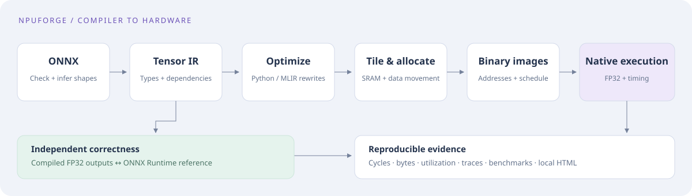
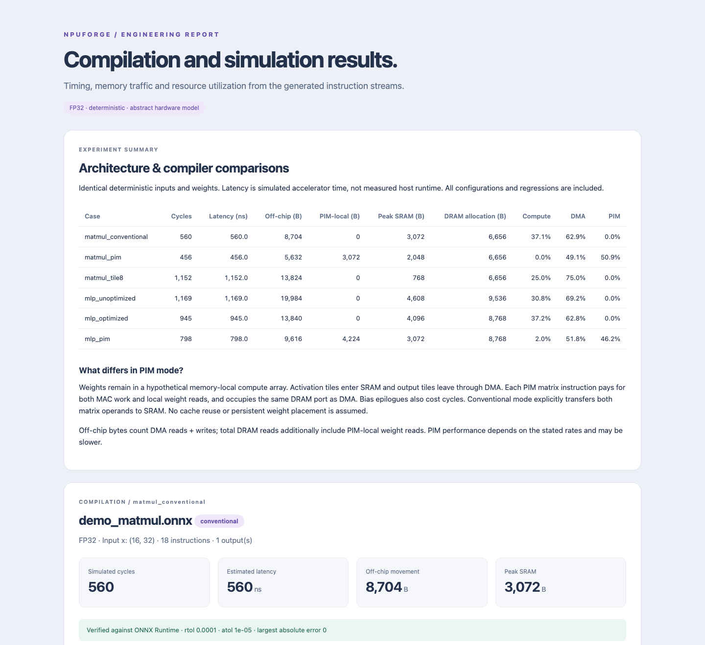

# NPUForge Hardware

**A hardware-aware ONNX compiler with executable NPU binary images.** Import static
FP32 models, optimize a typed graph, allocate DRAM/SRAM addresses, schedule and encode
instructions, then execute them in a native C++17 interpreter and hardware simulator.



The complete pipeline runs on a normal CPU. C++ decodes the binary instructions,
executes addressed FP32 arithmetic and schedules compute, DMA and PIM resources.
ONNX Runtime independently checks the resulting tensors. Saved programs run without
the original ONNX model. No accelerator, account or downloaded model is required.

## Relationship to the original project

This repository develops the hardware-aware compiler backend and MLIR/LLVM path
on top of [NPUForge, the original ONNX compiler and timing simulator](https://github.com/guhanp09/npuforge).
The original repository retains the graph compiler, tiler and performance simulator;
this repository adds concrete lifetime allocation, executable instruction/weight
images, native binary arithmetic and the registered MLIR compiler path.

The Python package and CLI retain the name `npuforge`. Use a separate virtual
environment for each repository.

## Quick start

Prerequisites: Python **3.11+** and a C++17 compiler. On macOS, install Apple's
Command Line Tools (`xcode-select --install`) if needed. On Ubuntu, install
`python3-venv` and `build-essential`. CMake and pybind11 are provisioned automatically
in pip's isolated native build.

```bash
git clone https://github.com/guhanp09/npuforge-hardware.git
cd npuforge-hardware
python3 -m venv .venv
source .venv/bin/activate
python -m pip install --upgrade pip
python -m pip install .
npuforge demo
```

Open **`output/report.html`** in any browser. It is fully self-contained. The demo
creates two real ONNX models, verifies both, and runs all six compiler/architecture
comparisons. Each case includes real instruction/weight images, a manifest, memory
map, schedule, input/output tensors, IR and the native execution trace.

Actual excerpt from the default run:

```text
mlp_optimized · demo_mlp.onnx · conventional
  [PASS] ONNX validation / graph import / IR verification
  [PASS] Optimization: 5 → 3 ops; 0 dead; 1 fused
  [PASS] Hardware lowering: 35 instructions
  [PASS] Native C++ simulation / numerical verification against ONNX Runtime
  [PASS] Address allocation / memory-aware scheduling / binary encoding and loading
  Images 9,176 B instructions, 4,416 B weights; DRAM allocation 8,768 B
  Cycles 945  |  Latency 945 ns  |  Off-chip 13,840 B  |  SRAM peak 4,096 B
```



## What is implemented

- **ONNX importer:** validation, shape inference, FP32 initializers, public inputs
  and outputs, dependencies, and explicit rejection of unsupported models.
- **Compiler IR:** tensor shapes/types, operations and attributes, graph invariants,
  stable topological order, producer/consumer maps, readable text, deterministic
  JSON serialization and round trips.
- **Real optimization:** backwards dead computation elimination and safe
  `MatMul → Add → Relu` and `Gemm → Relu` fusion, preserving observable/shared intermediates.
- **Hardware backend:** M/N/K tiling, boundary handling, accumulation, explicit
  DMA and SRAM allocation/release, conventional and memory-local matrix mappings.
- **Memory and code generation:** aligned lifetime allocation and reuse, baseline
  and memory-aware operator scheduling, versioned little-endian instruction records,
  real FP32 weights, checksummed manifests and a validating standalone loader.
- **Native execution:** addressed FP32 tile arithmetic, buffer ownership, operand
  provenance and transfer-completion checks.
- **Native simulator:** deterministic event scheduling, dependency checks, SRAM
  pressure, compute/DMA/PIM contention, a shared DRAM port, execution traces,
  modeled latency, movement, utilization and resource pressure analysis.
- **Verification and presentation:** compiled-output comparisons against ONNX
  Runtime, reproducible architecture/fusion/scheduling benchmarks, offline HTML
  graphs, timelines and SRAM lifetimes, malformed-image and bounded stress tests.

## Run your own model

```bash
npuforge inspect output/models/demo_mlp.onnx
npuforge inspect output/models/demo_mlp.onnx --json
npuforge compile output/models/demo_mlp.onnx --compare --output output/custom
npuforge compile output/models/demo_mlp.onnx --no-opt --output output/baseline
npuforge compile output/models/demo_matmul.onnx --config configs/pim.json --output output/pim
npuforge benchmark --output output/benchmarks
npuforge benchmark --compare-schedulers --output output/schedulers
npuforge inspect-program output/custom/conventional
npuforge run output/custom/conventional --inputs output/custom/conventional/inputs.npz
npuforge verify output/models/demo_mlp.onnx --compiled output/custom/conventional
```

`compile` always imports, compiles, simulates, verifies, and writes a report. Use
`--arch conventional|pim` to override the configuration's architecture. Hardware
configurations are plain JSON, with validated capacities, rates, setup costs,
clock and tile bounds. Errors return a nonzero exit status with an actionable
message. A single-target compile writes to `output/<architecture>/`; `--compare`
writes both targets. `run` accepts NPZ inputs keyed by manifest name, or NPY for one
input. `verify` generates deterministic inputs if none are supplied.
[Examples](examples/README.md) show the complete workflow.

## Optional MLIR compiler path

A native LLVM/MLIR 19 tool implements the registered `npuforge` tensor dialect,
SSA fusion/dead-code rewrites and conversion to Linalg/Arith/Tensor. Its exported
optimized graph feeds the same allocator, scheduler, binary generator and native
interpreter as the Python frontend. This path does not call the Python optimizer.

```bash
# macOS toolchain; the default compiler does not require LLVM.
brew install llvm@19
python scripts/build_mlir.py --llvm-prefix "$(brew --prefix llvm@19)"
export NPUFORGE_MLIR_OPT="$PWD/build/mlir/npuforge-opt"
npuforge demo --compiler mlir --output output/mlir-demo
python examples/compare_mlir.py
```

`compile`, `demo` and `benchmark` accept `--compiler mlir` and `--mlir-opt PATH`.
Add `--emit-llvm --llvm-bin /path/to/llvm19/bin` to generate verified LLVM IR through
upstream bufferization and dialect-conversion passes. The NPU executable still
comes from the optimized graph bridge; the LLVM output is a separate CPU lowering.
Tests compile that LLVM IR with Clang and compare actual CPU outputs against ONNX
Runtime, including scalar broadcasting and transposed/scaled Gemm.

Each MLIR run saves `original.mlir`, `optimized.mlir`, `frontend.graph.json`,
`lowered.linalg.mlir` and `mlir.json`; LLVM emission also saves `lowered.llvm.mlir`
and `model.ll`. The comparison report shows identical NPU cycles/traffic for both
compiler paths on the reference MLP. No speedup is attributed to MLIR itself.
See [MLIR design, Linux setup and validation](docs/mlir.md).

## Compiler and simulator decisions

The importer accepts default-domain ONNX opsets **13–18** with positive static
shapes. `MatMul` supports **rank-2 `(M,K) @ (K,N)`**. `Gemm` supports rank-2
`alpha * op(A) @ op(B) + beta * C`, both transpose flags, finite FP32 coefficients,
and an optional bias C that broadcasts into `(M,N)`. `Add` supports modern ONNX
multidirectional broadcasting, including scalars; `Relu` supports static tensors.
Only finite FP32 initializers are accepted. Unknown operations and attributes,
custom domains, sparse weights and unresolved shapes are rejected.

Generate and compile a dense layer:

```bash
python examples/generate_models.py --output output/models
npuforge compile output/models/demo_gemm.onnx --compare --output output/gemm
```

The example uses transposed weight storage, alpha 0.75 and beta 0.5. It verifies
against ONNX Runtime and reports 651 conventional / 547 PIM simulated cycles with
the default hardware. Scaling and bias arithmetic cost cycles on the final K tile;
transposed addressing uses the model's existing ideal DMA/local gather abstraction.
Unoptimized Gemm remains a distinct IR operation. Eligible
`Gemm → Relu` chains become `FusedGemmRelu`; shared or public Gemm results remain
observable. The activation executes only after the final reduction, scaling and
bias addition, with its arithmetic counted in the native simulation.

Compare fusion on both architectures in one report:

```bash
python examples/compare_gemm_fusion.py
```

Open `output/gemm-fusion/report.html`. On the deterministic example, fusion reduces
conventional cycles **791 → 675** and PIM cycles **687 → 571**, avoiding **3,072 B**
of off-chip movement in either mapping. The complete four-case results, including
unoptimized baselines, are in [the fusion benchmark](benchmarks/gemm_fusion_results.md).

The IR is independent of ONNX protobufs. Fusion removes intermediate materialization
and executes the bias/activation epilogue on the final reduction tile.
The lowerer reserves all input, weight,
accumulator and optional bias staging before issuing a tile, and reduces tile sizes
until they fit. It spills operation outputs to DRAM and conservatively uses a single
tile workspace. A deterministic lifetime allocator reuses dead DRAM buffers; the
memory-aware scheduler favors ready operations that release more temporary storage.
It preserves the conservative tile barriers and does not promise better latency.

The C++ simulator can overlap independent compute and DMA instructions, enforcing
exclusive resources and live SRAM capacity. Total cycles are the **last completion
timestamp**, so overlapping work is not double-counted. Busy cycles divided by that
makespan give per-resource utilization. Allocation deadlocks, invalid dependencies,
unknown instructions, unsafe frees and oversized working sets fail clearly.

In PIM mode, the right matrix operand stays in a hypothetical memory-local array.
Activation/bias loads and output stores still use DMA. PIM pays separately for MACs
and local weight reads and contends with DMA for the DRAM port. The comparison uses
a different mapping and placement assumption, not an arbitrary speed multiplier.
See the complete [architecture and timing specification](docs/architecture.md).

## Verified reference benchmarks

Workload: `(16,32) @ (32,24)`; MLP adds bias/Relu then `(16,24) @ (24,12)` and bias.
Weights use seed 11, inputs seed 7. Default clock is 1 GHz, SRAM 64 KiB, tile
`(16,16,16)`, conventional/PIM throughput 64 MACs/cycle, DMA 32 B/cycle, local PIM
reads 128 B/cycle. Setup and epilogue costs are included.

| Case | Cycles | Latency (ns) | Off-chip bytes | PIM-local bytes | Peak SRAM (B) |
| :--- | ---: | ---: | ---: | ---: | ---: |
| MatMul conventional | 560 | 560 | 8,704 | 0 | 3,072 |
| MatMul PIM | 456 | 456 | 5,632 | 3,072 | 2,048 |
| MatMul tile `(8,8,8)` | 1,152 | 1,152 | 13,824 | 0 | 768 |
| MLP unoptimized | 1,169 | 1,169 | 19,984 | 0 | 4,608 |
| MLP optimized | 945 | 945 | 13,840 | 0 | 4,096 |
| MLP optimized PIM | 798 | 798 | 9,616 | 4,224 | 3,072 |

These are **simulated accelerator estimates**, not host inference measurements or
real-chip predictions. Off-chip bytes count DMA reads/writes; DRAM reads additionally
include PIM-local reads, reported separately to prevent double counting. The smaller
tile saves SRAM but is slower and moves more bytes. PIM advantages depend on the
configured rates and placement assumptions; they are not universal.

[Full results and utilization](benchmarks/results.json),
[reference environment](benchmarks/environment.json), and
[reproduction details](benchmarks/README.md) are checked in. To refresh figures and
tables from real runs: `python scripts/refresh_artifacts.py` after a dev install.


## Development and tests

```bash
python -m pip install -e '.[dev]'
python -m pytest -q
ruff check .
ruff format --check .
clang-format --dry-run --Werror cpp/include/*.hpp cpp/src/*.cpp cpp/tests/*.cpp
cmake -S . -B build/native -DNPUFORGE_PYTHON=OFF -DCMAKE_BUILD_TYPE=Release
cmake --build build/native --parallel 2
ctest --test-dir build/native --output-on-failure
python -m build
```

Reinstall the editable package after C++ changes; Python source changes are immediate.
Tests cover ONNX/IR rejection and invariants, fusion branch safety, dead computation,
broadcasting, tile arithmetic and coverage, memory pressure, deterministic random
graphs, native contention, report accuracy/escaping, CLI failures and complete demos.
Numerical tolerances are **rtol `1e-4`, atol `1e-5`**. Native hand calculations cover
single compute/transfer, dependency serialization, independent overlap, resource
contention, PIM/DRAM sharing, allocation lifetime, deadlock and repeatability.

The GitHub Actions workflow covers builds, formatting, Python/native tests, binary
execution, examples and packaging on macOS and Linux, plus a separate MLIR build.
See [validation evidence](docs/validation.md) for locally executed checks and
[GitHub Actions](https://github.com/guhanp09/npuforge-hardware/actions) for hosted
results and downloadable reports. The MIT-licensed source is published at
[guhanp09/npuforge-hardware](https://github.com/guhanp09/npuforge-hardware).

The tested dependency snapshot is available in `requirements-tested.txt` for Python
3.12. To repeat Linux validation locally with Docker (source mounted read-only):

```bash
docker run --rm --platform linux/amd64 \
  --mount "type=bind,src=$PWD,dst=/source,readonly" \
  python:3.12-slim-bookworm sh /source/scripts/validate_linux.sh
```

## Scope

NPUForge supports a small set of static FP32 operations. Its C++ engine executes
binary tensor instructions and models resource timing. The model has not been
validated against silicon and does not simulate detailed hardware pipelines. It does not model physical
banks, caches, detailed pipelines, energy, quantization, dynamic shapes, batched
MatMul, convolution or arbitrary ONNX graphs. DRAM and SRAM address spaces each
have a 64 MiB interpreter limit; the default scratchpad is 64 KiB.
The hardware model is hypothetical and does not represent a commercial chip.

Backend details: [pipeline and artifacts](docs/compiler_backend.md),
[binary specification](docs/instruction_format.md),
[memory planning](docs/memory_planning.md), [scheduling](docs/scheduling.md).
See [CHANGELOG.md](CHANGELOG.md) for version history.

## License

[MIT](LICENSE).
